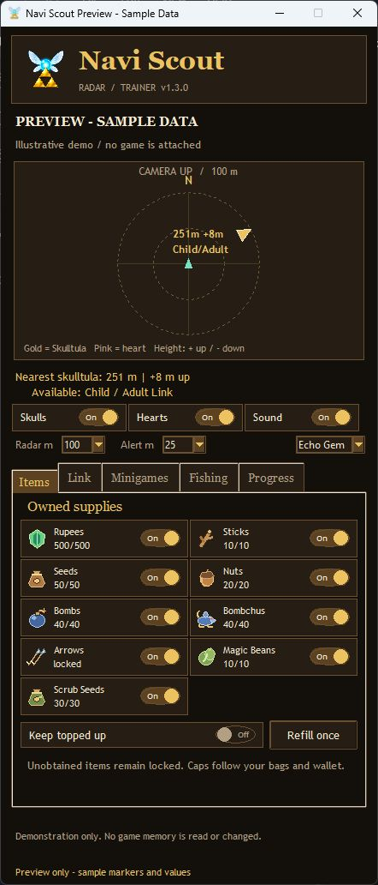
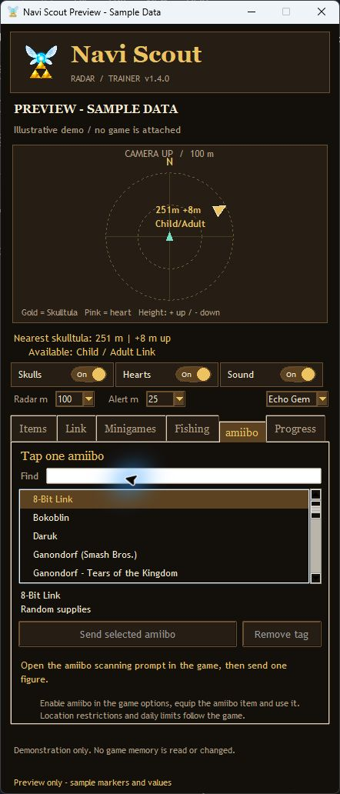
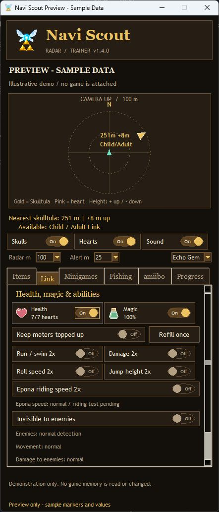
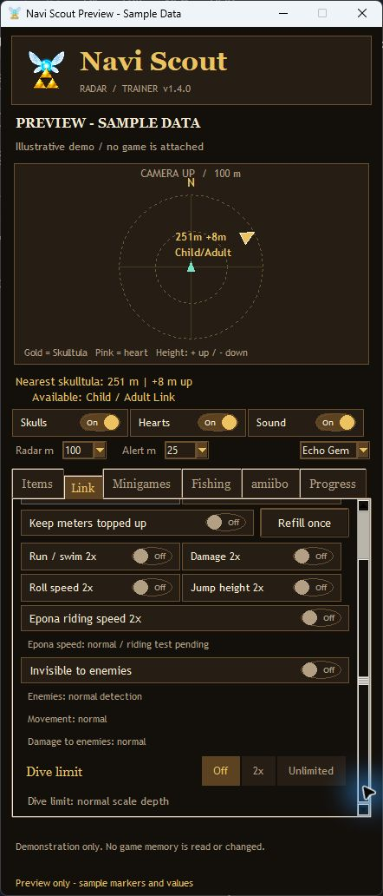
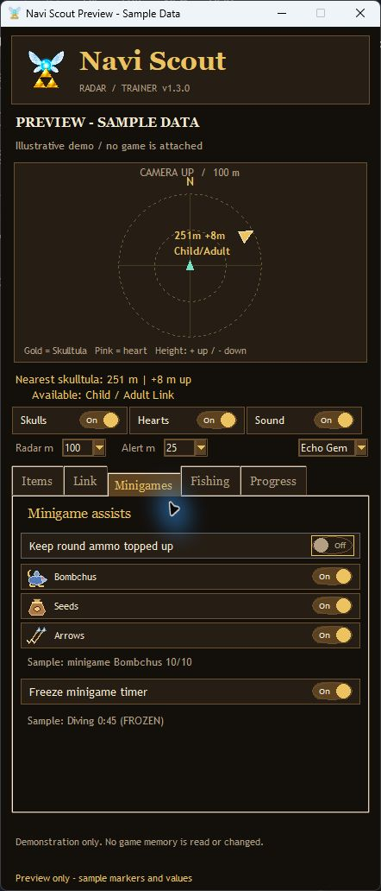
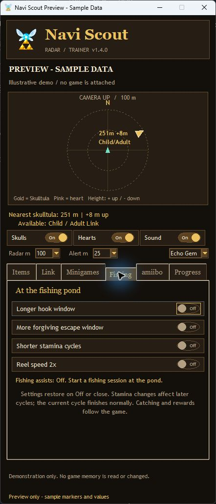
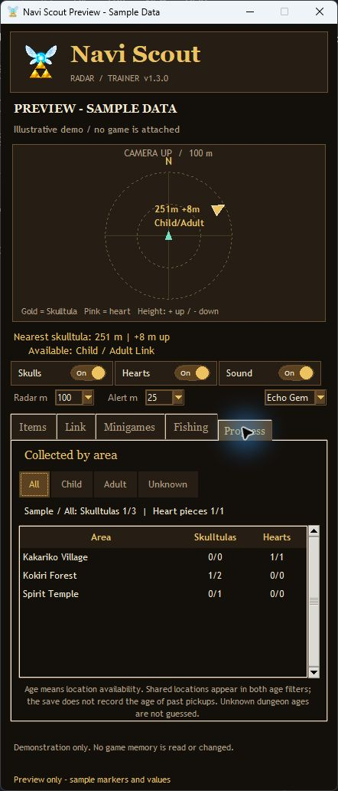

# Navi Scout

A standalone Windows companion for **NX2navi**: camera-relative collectible guidance, optional supply refills, and minigame assists. Install it separately from the game.

**[Download the latest release](https://github.com/jfhutchi/NaviScout/releases/latest)**

Release **1.4.0** adds an **amiibo** tab with 35 individually selectable virtual-reader presets: 33 released Zelda figures and the two upcoming mask models defined by the game. It filters the list against your own game's compatibility rules and sends only the selected figure through NX2navi's native reader while the game is scanning. Native scanning and supply drops have been verified live on NX2navi 0.10.1 and confirmed working by the player; every preset and the upcoming mask rewards have not been exhaustively tested. The new native reader adapter validates the 0.10.1 executable layout; other layouts are rejected. This release passes 233 automated tests, including catalog filtering, one-at-a-time sends, reader readiness, in-flight cleanup and actual Windows file-lock installer checks.

This release also fixes radar filtering after seamless area changes, including Lake Hylia and Lon Lon Ranch inside the Hyrule Field scene, and skips byte-identical locked runtime files during installer updates. Changed locked files still stop the update.

Release **1.3.0** adds a dedicated **Fishing** tab, original illustrated item controls, an Echo Gem proximity-alert sound extracted privately from each player's own game, and Navi Scout artwork at the installer's upper right. Fishing switches start Off and operate only during a validated fishing session; the player confirmed the fishing assists work in a session on NX2navi 0.10.1. This build also fixes magic refills rejecting retained spell/item command values after using Lens of Truth or the Echo Gem. The native binding field was previously mistaken for a maximum; refills now validate the real owned GameData capacity while preserving magic messages and costs. Temporary refill-readiness errors also leave the collectible radar and area progress active.

Release **1.2.2** replaces global player-perception suppression with enemy-only filters after a report that enabling stealth stopped Navi following Link. The new filters reject only the current player's signal for Enemy receivers, including copied and retained detections. Navi and friendly receivers keep the original path. The player confirmed Navi follows Link again with stealth enabled on NX2navi 0.10.1. Native-helper tests, code tracing and review cover the enemy-only filters; a live enemy encounter with this replacement is still pending. It also adds a separate Epona riding speed 2x switch, with automated mount/restore tests; live riding verification is pending because Epona is not unlocked in the development save.

The 1.2 series restores signed height guidance, adds Child/Adult availability labels and a **Progress** tab with collected totals by area, and fixes chest-based heart rewards remaining on the radar after collection. Existing private catalogs update automatically from the recipient's own game files. The **Link** tab also adds an independent **Damage 2x** switch for Link-owned attacks against enemies. The in-game-menu-inspired design, Navi/Triforce icon, refills, movement, stealth and dive controls remain available. **Tested on NX2navi 0.9.2 and 0.10.1**; the new damage control has automated native-helper and code-trace coverage, with live combat verification still pending.

**[See the illustrated preview before installing](docs/START-HERE.html)**



*Illustrative preview using labeled sample data. No game is attached in this screenshot.*

## Compatibility

- Windows 10/11, x64. Tested on the development PC; a separate clean-PC test is still recommended.
- NX2navi game executable `ocarina.exe`, with extracted game build **E0F3CCFAF50065AE** (tested with NX2navi 0.9.2 and 0.10.1).
- Native run/swim selects verified 0.9.2 and 0.10.1 code layouts. The replacement enemy-only stealth currently has a validated layout for the development PC's 0.10.1 executable; its 0.9.2 layout has not been verified. The former global-suppression fallback has been removed. Damage uses its verified shared hit-processing layout. Compatibility checks actual code rather than version labels. Another rebuild may require a new validated layout; an unrecognized running callback leaves jump and roll available.
- Other game builds, Hookshot, Lichii and emulators are not supported by this release.
- You provide your own installed game. No ROM, game executable, game assets, save or collectible catalog is distributed.

## Install

1. Download a release and extract the entire ZIP.
2. Open **START-HERE.html** to review screenshots, features and limitations.
3. Run the included **NaviScout-Setup-<version>.exe**, then choose **Install Navi Scout**. No Python or administrator installation is required.
4. Start Navi Scout. Close NX2navi once, choose your own `ocarina.exe`, and select **Prepare my game**.
5. Setup copies and SHA-256 verifies your existing game profile, then generates your private radar catalog from your game files.
6. Play normally. Use **F8** to hide/show the companion.

New installations start with refills, round ammo, timer freeze, movement, damage, stealth and dive overrides **off**. Each tab has its own controls, saved for your Windows account. Existing refill choices are migrated without enabling previously inactive assists.

To update an existing installation, close Navi Scout and run the new installer. Your game connection, settings and backups are retained. When installation finishes, choose **Open Navi Scout**. Later, use the **Navi Scout** Desktop or Start menu shortcut; F8 shows or hides an already running trainer. For the portable version, extract the new application into a separate folder and run `NaviScout.exe` after closing the old copy.

This is an unsigned community application. Review the source and release checksums before running it. No antivirus or Windows security setting needs to be disabled.

## Features

| Feature | Behavior |
| --- | --- |
| Collectible radar | Missing Golden Skulltulas and heart-piece locations, filtered by area and live collection flags |
| Orientation | Camera-up, with a moving world-north indicator |
| Off-range guidance | An edge arrow toward the closest enabled missing collectible outside the radar circle |
| Alerts | Separate skull/heart switches, adjustable distance and optional Echo Gem / System beep sound |
| Height and age | Signed + / - height to the mapped location; Child, Adult, shared or unspecified age availability |
| Area progress | Deduplicated collected/total Skulltulas and heart locations per area; All, Child, Adult and Unknown age filters |
| Supplies | Rupees, sticks, seeds, nuts, bombs, Bombchus, arrows, Magic Beans and Scrub seeds |
| Ownership | Unobtained items stay locked; bag/wallet upgrades determine capacity |
| Link meters | Separate health/magic controls refill existing containers/meters; grant no upgrades or abilities |
| Run / swim speed 2x | Doubles normal running translation and swimming speeds, including swim dash and heavy variants |
| Epona riding speed 2x | Independently doubles Epona's four riding-gear speeds only while Link rides her; restores the original cache on dismount, Off or close; live riding test pending |
| Roll speed 2x | Separate roll boost using the effective ground-speed scale; independent of running |
| Invisible to enemies | Perception-based stealth; Link stays visible to the player |
| Damage 2x | Doubles positive processed damage from Link-owned attacks against current enemies, before the game's final damage rules |
| Jump height 2x | Doubles the normal jump-height setting; does not add a new jump button |
| Dive limit | Off, 2x current scale depth, or Unlimited depth during normal dives |
| Fishing | Independent hook-window, escape-window, shorter stamina-cycle and hooked-fish reel-speed assists; player-confirmed in a session on NX2navi 0.10.1; bass support only |
| amiibo | Search 35 compatible presets and send one selected virtual figure through the native reader; game restrictions and daily limits apply |
| Minigame ammo | Independent Bombchu, seed and arrow choices, bounded by the round's supplied allowance |
| Timer hold | Optional current-time hold for diving, Dampe's race, horse race, cucco search and running race |

Magic Beans cap at 10 and Scrub seeds at 30. Bombchus require ownership and use the bomb-bag cap. A rented minigame item may refill during its round even if its normal inventory bag is not owned. Bottle contents, quest/trade items, rewards and equipment are not granted. Fire/ice/light arrows share normal arrows and magic; no elemental arrow is unlocked.

## Using the six tabs

- **Items:** choose owned supplies, then use **Keep topped up** or **Refill once**.
- **Link:** choose health and magic, then use their separate **Keep meters topped up** or **Refill once**. Toggle **Run / swim speed 2x**, **Roll speed 2x** and **Jump height 2x** independently. Run and swim share one switch; dive depth remains separate.
- **Link / Epona riding speed 2x:** a separate, default-Off toggle. It waits until Link is mounted on adult Epona and her speed cache is initialized. It changes her four riding speeds, leaving acceleration, Link's on-foot speed, horse ownership and unlock progress unchanged. Dismounting, switching Off or closing restores the original cache. If the game refreshes HorsePower, the boost pauses until an observed dismount/remount so partially refreshed values cannot be doubled again. The Link tab scrolls to keep the lower dive controls accessible. Live riding is unverified until Epona is unlocked.
- **Link / Dive limit:** select **2x** for twice the current scale's depth (3/6/9 m becomes 6/12/18 m), or **Unlimited** to remove that depth cutoff. Select **Off** to restore the normal limit. Scale ownership is unchanged.
- **Link / Invisible to enemies:** turn on before approaching an enemy. The enemy-only filters reject Link's new, copied and retained perception records for current Enemy receivers. Navi and friendly receivers retain the original detection path. Independently remembered aggro, scripted fights and bosses may still attack. Link stays visible to you. Navi following Link with this replacement enabled is player-confirmed; a live enemy encounter remains pending.
- **Link / Damage 2x:** toggle independently of movement or refills. The shared hit-processing stage checks the target's current enemy affiliation and follows validated attack ownership back to Link, covering melee and owned projectiles instead of changing individual weapon resources. Incoming damage to Link is unchanged. Enemy immunity, forced-one-damage rules, scripted caps and enemy-specific callbacks still apply. Individual weapons have not yet been confirmed in live combat.
- **Minigames:** choose the round ammo types and enable **Keep round ammo topped up**. **Freeze minigame timer** remains a separate option.
- **Fishing:** independent, default-Off assists for the active fishing session and current bass. Rare-fish types and unsupported inherited resource layouts remain unavailable. Use the status message to see whether the rod and current fish are ready. Switching Off or closing restores original parameters; equipment, records and rewards remain under the game's rules. The stamina assist affects subsequent cycles; it does not rewind a cycle already running.
- **Progress:** read collected/total counts for each area. Choose **Child** or **Adult** to filter by location availability; shared collectibles appear in both filters and only once in **All**. **Unknown** includes dungeon locations whose maps do not specify an age. The save does not record which age Link was when a past pickup happened.
- **amiibo:** enable amiibo in the game's System / Options, equip the amiibo item and use it to open a fresh scanning prompt before each figure. In Navi Scout, find and select a figure, then choose **Send selected amiibo**. Each press sends one figure; there is no batch or automatic scanning. **Remove tag** clears the emulated reader. The game decides location eligibility, daily limits and rewards. A successful native tap means the tag reached the reader; check the game for its reward result. Preset identifiers stay stable across repeated sends. Physical dumps, encryption keys and game resources are not included.

Each selected virtual tag is generated in the connected game's `amiibo/NaviScout` folder so the native reader can open it. Existing game assets and saves are not rewritten.



Figure names and released identifiers were checked against [AmiiboAPI metadata](https://github.com/8bitDream/AmiiboAPI/blob/master/database/amiibo.json). The two upcoming mask-model numbers come from the recipient's own game. Nintendo describes the supported figures and scan steps in its [Ocarina of Time amiibo instructions](https://en-americas-support.nintendo.com/app/answers/detail/a_id/71861/).











The **Echo Gem / System beep** selector beside the radar range chooses the proximity sound; **Sound** still enables or disables alerts. The Echo Gem cue is decoded locally from your own game into `%LOCALAPPDATA%\NaviScout\media`. It is not included in downloads. If unavailable, the status explains the System beep fallback. Item illustrations are original vector artwork, not extracted game textures.

## Limits and verification

- The radar is a separate companion window; it does not patch the original map. Its locally generated catalog covers 100 Skulltulas and 36 heart locations. A marker may still require night, equipment, another floor or progression. Signed height refers to the mapped location, which can be a grotto entrance or reward anchor rather than the pickup's exact position.
- Age labels are derived from the game's Child/Adult map variants: all 36 heart locations and 53 overworld Skulltulas have age metadata. The remaining 47 dungeon Skulltulas are labeled unspecified, rather than assigning an unverified age. Availability is not a claim that the current equipment, time of day or quest state meets every requirement.
- Heart completion follows the game's three conditions: loose pickup actor IDs, chest rewards mapped to their saved boolean, and named reward flags. Version 1.2 fixes the second case. A read-only check of the development save reproduced four collected locations incorrectly remaining visible and corrected the count from 16 to 20; the save itself was unchanged.
- Resource checks run every quarter second. Health is refilled, not made invulnerable; zero health is not resurrected, and lethal damage can still occur between updates.
- Timer hold updates the shared minigame clock every 25 ms. Tiny subsecond movement can occur; games using different internal timing are outside its scope. Timed trading quests are excluded through active quest-stage checks.
- Normal dives end at a depth cutoff; the dive option changes that cutoff, not an oxygen countdown. Unlimited depth retains normal swimming, input, collision and surface rules. It does not add free swimming, unlock equipment, or claim immunity to every underwater hazard.
- Movement and dive overrides restore on switching Off or closing the helper. They change live memory only. If the helper is forcibly terminated or reports an unsuccessful restore, restart NX2navi to clear remaining overrides.
- Running uses a checked temporary override at normal movement's translation callback. It leaves turning speed and other action callbacks alone. Swimming doubles the owned player's existing normal, heavy, dash and heavy-dash speed settings, retaining the original values and inheritance flags for restoration. It does not change vertical dive speed or dive depth.
- Enemy stealth filters the shared new-candidate and copied-record collectors, with complete code-hash checks for both helpers and their calling collector. It does not write actor/emitter state or perception-disable reasons. Off restores both original entries and releases the helpers after all game threads have left them. Restart NX2navi after forcibly terminating an older trainer, because an old global-disable reason may remain in that game session.
- Closing the helper stops all cheats. Hiding with F8 does not stop them. Loading/transition states pause writes, and unsupported data layouts are rejected.
- This release passes 233 automated tests, including 26 fishing tests, private audio decoding and item-icon controls, magic-command payload preservation, real magic-capacity guards, radar isolation from refill-readiness errors, mounted-Epona ownership and generation checks, non-compounding gear overrides, dismount/Off/close restoration, HorsePower refresh holds, paused write transactions and scroll access to dive controls, plus executable enemy-filter tests for both ingress paths, friendly receiver preservation, guest CPU-state preservation, code restoration, interrupted two-hook installations, exact parameter restoration, chest-reward completion, age/progress deduplication and separate control preferences. Damage-helper tests execute the native filter for direct and creator-owned attacks, rejecting stale links, cycles, non-enemies, player targets and unsafe values. Its common damage stage was traced across nine native call paths; live combat and individual weapon coverage remain unverified. The player confirmed running, swimming, rolling, jumping and both dive modes work in earlier builds. The player confirmed Navi follows Link with the replacement stealth enabled on NX2navi 0.10.1. Earlier enemy-detection On/Off checks exercised the replaced global mechanism; a live enemy encounter with the new filters is still pending.
- Bombchu bowling refills and a retained health refill were observed during live play. The user confirmed the diving timer hold worked. Other minigame modes have code-trace and automated coverage, but have not all been tested in live rounds.
- The release includes a machine-readable verification report for automated, extraction and packaging checks. A different PC's driver/security environment may behave differently.

## Scarecrow Song on NX2navi

An upstream report describes Scarecrow Song playback stopping after its first note in the Forest Temple while background animations continue. A commenter reports that setting the game frame limit to **60 FPS** lets playback proceed; limits above 60 can trigger the problem. See [NX2navi issue #777](https://github.com/tangerineturtle1/NX2navi/issues/777#issuecomment-6842911792). The player confirmed that the 60 FPS cap resolves the same Forest Temple stall on NX2navi 0.10.1. This confirms the workaround for that encounter; the underlying engine defect has not been traced. Navi Scout does not change the game frame limit.

## Your data and removal

Application files: `%LOCALAPPDATA%\Programs\NaviScout`.

Settings, private radar catalog, logs and verified profile backups: `%LOCALAPPDATA%\NaviScout`.

Uninstall through Windows **Installed apps**, or the Start menu's **Uninstall Navi Scout** shortcut. It removes Navi Scout and its shortcuts while retaining your game, settings and backup folder. There is no service, scheduled task, startup task, network listener or telemetry.

To restore a profile, close the game and helper, preserve the current profile, then copy a verified backup's complete `profile` folder back to the game. Keep the save journal and other profile files together.

## Build and test from source

Use 64-bit Python 3.12 with Tk support on Windows:

```powershell
py -3.12 -m venv .venv
.\.venv\Scripts\python.exe -m pip install -r requirements-build.txt
$env:PYTHONPATH = "$PWD\app;$PWD\packaging"
.\.venv\Scripts\python.exe -m unittest discover -s tests -v
.\.venv\Scripts\python.exe packaging\build_release.py
```

The build creates a standalone application, an offline per-user installer, a source archive and a preview inside `release`. A whitelist excludes local saves, catalogs, preferences, logs, caches and the development environment. The installer is implemented in this repository, so no external installer compiler is needed.

## Upstream offer and license

Navi Scout is an independent community companion, offered to the NX2navi developer for review, reuse or integration. It is not an official NX2navi or Nintendo release. The original project is [tangerineturtle1/NX2navi](https://github.com/tangerineturtle1/NX2navi).

Navi Scout's original source is MIT licensed; see [LICENSE](LICENSE). Bundled runtime dependencies retain their own licenses, shipped in `licenses` and described in [THIRD-PARTY-NOTICES.txt](THIRD-PARTY-NOTICES.txt). Game titles and trademarks belong to their respective owners.
