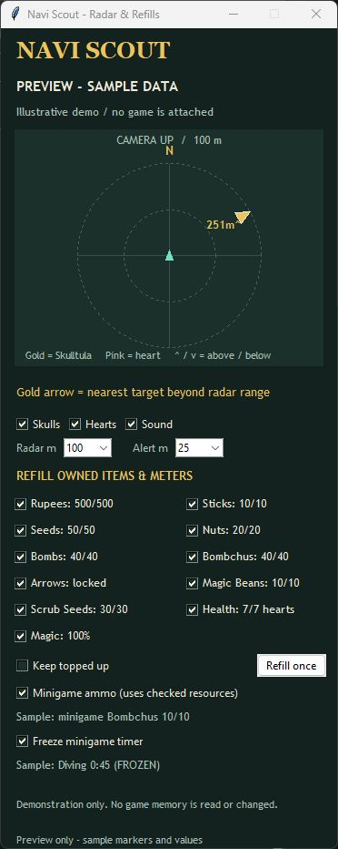

# Navi Scout

A standalone Windows companion for **NX2navi**: camera-relative collectible guidance, optional supply refills, and minigame assists. Install it separately from the game.

**[See the illustrated preview before installing](docs/START-HERE.html)**



*Illustrative preview using labeled sample data. No game is attached in this screenshot.*

## Compatibility

- Windows 10/11, x64. Tested on the development PC; a separate clean-PC test is still recommended.
- NX2navi game executable `ocarina.exe`, with extracted game build **E0F3CCFAF50065AE** (tested with NX2navi 0.9.1).
- Other game builds, Hookshot, Lichii and emulators are not supported by this release.
- You provide your own installed game. No ROM, game executable, game assets, save or collectible catalog is distributed.

## Install

1. Download a release and extract the entire ZIP.
2. Open **START-HERE.html** to review screenshots, features and limitations.
3. Run **NaviScout-Setup-1.0.0.exe**, then choose **Install Navi Scout**. No Python or administrator installation is required.
4. Start Navi Scout. Close NX2navi once, choose your own `ocarina.exe`, and select **Prepare my game**.
5. Setup copies and SHA-256 verifies your existing game profile, then generates your private radar catalog from your game files.
6. Play normally. Use **F8** to hide/show the companion.

The companion starts with automatic refills and timer freeze **off**. Check the supplies you want and enable **Keep topped up**, or use **Refill once**. Every setting is saved for your Windows account.

This is an unsigned community application. Review the source and release checksums before running it. No antivirus or Windows security setting needs to be disabled.

## Features

| Feature | Behavior |
| --- | --- |
| Collectible radar | Missing Golden Skulltulas and heart-piece locations, filtered by area and live collection flags |
| Orientation | Camera-up, with a moving world-north indicator |
| Off-range guidance | An edge arrow toward the closest enabled missing collectible outside the radar circle |
| Alerts | Separate skull/heart switches, adjustable distance and optional sound |
| Supplies | Rupees, sticks, seeds, nuts, bombs, Bombchus, arrows, Magic Beans and Scrub seeds |
| Ownership | Unobtained items stay locked; bag/wallet upgrades determine capacity |
| Health and magic | Refills existing containers/meters; grants no upgrades or abilities |
| Minigame ammo | Temporary Bombchus, seeds or arrows, bounded by the round's supplied allowance |
| Timer hold | Optional current-time hold for diving, Dampe's race, horse race, cucco search and running race |

Magic Beans cap at 10 and Scrub seeds at 30. Bombchus require ownership and use the bomb-bag cap. A rented minigame item may refill during its round even if its normal inventory bag is not owned. Bottle contents, quest/trade items, rewards and equipment are not granted. Fire/ice/light arrows share normal arrows and magic; no elemental arrow is unlocked.

## Limits and verification

- The radar is a separate companion window; it does not patch the original map. Its locally generated catalog covers 100 Skulltulas and 36 heart locations. A marker may still require night, equipment, another floor or progression.
- Resource checks run every quarter second. Health is refilled, not made invulnerable; zero health is not resurrected, and lethal damage can still occur between updates.
- Timer hold updates the shared minigame clock every 25 ms. Tiny subsecond movement can occur; games using different internal timing are outside its scope. Timed trading quests are excluded through active quest-stage checks.
- Closing the helper stops all cheats. Hiding with F8 does not stop them. Loading/transition states pause writes, and unsupported data layouts are rejected.
- Bombchu bowling refills and a retained health refill were observed during live play. The user confirmed the diving timer hold worked. Other minigame modes have code-trace and automated coverage, but have not all been tested in live rounds.
- The release includes a machine-readable verification report for automated, extraction and packaging checks. A different PC's driver/security environment may behave differently.

## Your data and removal

Application files: `%LOCALAPPDATA%\Programs\NaviScout`.

Settings, private radar catalog, logs and verified profile backups: `%LOCALAPPDATA%\NaviScout`.

Uninstall through Windows **Installed apps**, or the Start menu's **Uninstall Navi Scout** shortcut. It removes Navi Scout and its shortcuts while retaining your game, settings and backup folder. There is no service, scheduled task, startup task, network listener or telemetry.

To restore a profile, close the game and helper, preserve the current profile, then copy a verified backup's complete `profile` folder back to the game. Keep the save journal and other profile files together.

## Build and test from source

Use 64-bit Python 3.12 with Tk support on Windows:

```powershell
py -3.12 -m venv .venv
.\.venv\Scripts\python.exe -m pip install -r requirements-build.txt
$env:PYTHONPATH = "$PWD\app;$PWD\packaging"
.\.venv\Scripts\python.exe -m unittest discover -s tests -v
.\.venv\Scripts\python.exe packaging\build_release.py
```

The build creates a standalone application, an offline per-user installer, a source archive and a preview inside `release`. A whitelist excludes local saves, catalogs, preferences, logs, caches and the development environment. The installer is implemented in this repository, so no external installer compiler is needed.

## Upstream offer and license

Navi Scout is an independent community companion, offered to the NX2navi developer for review, reuse or integration. It is not an official NX2navi or Nintendo release. The original project is [tangerineturtle1/NX2navi](https://github.com/tangerineturtle1/NX2navi).

Navi Scout's original source is MIT licensed; see [LICENSE](LICENSE). Bundled runtime dependencies retain their own licenses, shipped in `licenses` and described in [THIRD-PARTY-NOTICES.txt](THIRD-PARTY-NOTICES.txt). Game titles and trademarks belong to their respective owners.
